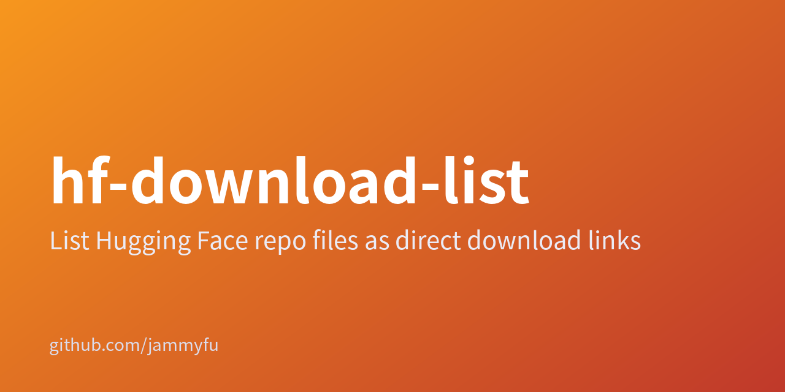

# hf-download-list



[English](README.en.md) · [简体中文](README.zh-CN.md) · [繁體中文（臺灣）](README.zh-TW.md) · [日本語](README.ja.md) · [한국어](README.ko.md)

## Turn a Hugging Face model repository into a file-link list

Use the CLI for one model or the web interface for multiple models. Export official resolve URLs as TXT or JSON; this tool does not download weights.

### A small model-file link workbench

| → | |
| --- | --- |
| [CLI and server source](../src/) | JSON / source |
| [Web interface source](../public/) | Browse |

The interface supports English and Chinese; these five-language guides do not add interface languages. Models only, not datasets or Spaces. Gated downloads still require the appropriate permissions; a generated URL does not grant access.

### Run tests

```bash
npm test
npm start
```

package.json declares MIT, but this repository has no LICENSE file. Ask the maintainer to confirm the license before relying on a redistribution grant.

[Repository README](../README.md)
