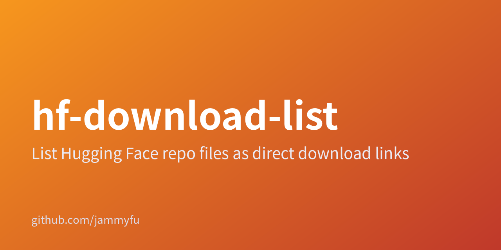

# hf-download-list



[English](README.en.md) · [简体中文](README.zh-CN.md) · [繁體中文（臺灣）](README.zh-TW.md) · [日本語](README.ja.md) · [한국어](README.ko.md)

## Hugging Face 모델 저장소를 파일 링크 목록으로 바꾸기

단일 모델은 CLI, 여러 모델은 웹 화면에서 처리합니다. 공식 resolve URL을 TXT 또는 JSON으로 내보내며 모델 가중치를 다운로드하지는 않습니다.

### 가벼운 모델 파일 링크 작업 도구

| → | |
| --- | --- |
| [CLI 및 서버 소스](../src/) | JSON / source |
| [웹 화면 소스](../public/) | Browse |

화면은 영어와 중국어를 지원합니다. 5개 언어 안내가 화면 번역을 추가하는 것은 아닙니다. 모델만 지원하며 데이터셋과 Spaces는 지원하지 않습니다. 제한된 파일은 여전히 권한이 필요하며 URL 생성만으로 접근 권한이 생기지는 않습니다.

### 테스트 실행

```bash
npm test
npm start
```

package.json은 MIT를 선언하지만 LICENSE 파일이 없습니다. 재배포 허가에 의존하기 전에 관리자에게 확인하세요.

[Repository README](../README.md)
