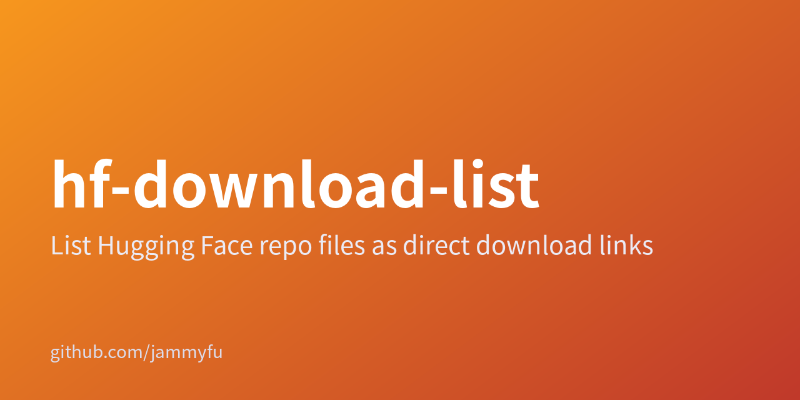

# hf-download-list



[English](README.en.md) · [简体中文](README.zh-CN.md) · [繁體中文（臺灣）](README.zh-TW.md) · [日本語](README.ja.md) · [한국어](README.ko.md)

## 把 Hugging Face 模型仓库变成文件直链清单

单模型用 CLI，多个模型用网页。导出官方 resolve 地址为 TXT 或 JSON；本工具不会下载模型权重。

### 轻量模型文件链接工作台

| → | |
| --- | --- |
| [CLI 与服务端源码](../src/) | JSON / source |
| [网页界面源码](../public/) | Browse |

界面支持中英文；五语指南不代表界面增加了语言。仅支持模型，不支持数据集或 Spaces。受限下载仍需相应权限，生成链接不等于获得访问权。

### 运行测试

```bash
npm test
npm start
```

package.json 声明 MIT，但仓库缺少 LICENSE 文件。依赖其再分发授权前请向维护者确认。

[Repository README](../README.md)
