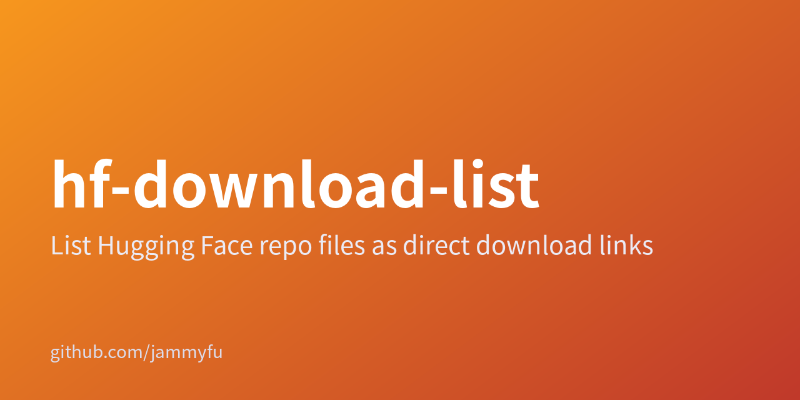

# hf-download-list



[English](README.en.md) · [简体中文](README.zh-CN.md) · [繁體中文（臺灣）](README.zh-TW.md) · [日本語](README.ja.md) · [한국어](README.ko.md)

## 將 Hugging Face 模型儲存庫轉為檔案直連清單

單一模型使用 CLI，多個模型使用網頁介面。將官方 resolve 網址匯出為 TXT 或 JSON；本工具不會下載模型權重。

### 輕量模型檔案連結工作台

| → | |
| --- | --- |
| [CLI 與伺服器原始碼](../src/) | JSON / source |
| [網頁介面原始碼](../public/) | Browse |

介面支援英文與簡體中文；五語指南不代表介面新增語言。僅支援模型，不支援資料集或 Spaces。受限下載仍需權限，產生連結不代表取得存取權。

### 執行測試

```bash
npm test
npm start
```

package.json 宣告 MIT，但儲存庫缺少 LICENSE 檔案。依賴其散布授權前請先向維護者確認。

[Repository README](../README.md)
